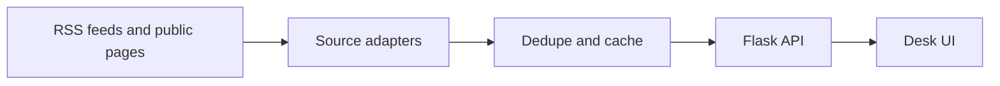

# Indian Stock News Tracker

An analyst covering about twenty Indian stocks should not have to open a different site for every name. This desk collects those headlines in one place, keeps a results calendar beside them, and can be pointed at a new watchlist without a code change.

NewsAPI is optional. Search works from public RSS when `NEWS_API_KEY` is empty.

## Problem

A markets analyst starts the day with a fixed list of companies and two indices. The headlines are spread across Moneycontrol, Economic Times, Mint, Yahoo Finance, and wire sites. Checking each name by hand is slow, and a page that fails should not wipe out the names that still responded. The same person also needs the next quarterly result date, which is a different job from "what was published this morning."

## Solution

A small Flask app searches one query across source adapters, prefers RSS, and falls back to a few existing page readers. Results are deduped, cached, and shown in the desk UI. A separate YAML file holds the customer watchlist. Quarterly dates stay in `data/watchlist.json` and are refreshed by a GitHub Actions job, not by the web process.

Optional two-to-three sentence summaries are off unless `ENABLE_SUMMARY` is set.

## Architecture



Each adapter has a timeout, up to three retries with backoff, and its own User-Agent. One adapter raising or timing out is logged and skipped. If every live source fails and an earlier copy is still in memory, the API sets `stale: true` and the page says it is showing an earlier copy.

`config.yaml` is the news watchlist (names, tickers, aliases such as Reliance / RELIANCE.NS / RIL). `data/watchlist.json` is the results list read by `scripts/refresh_results.py` and `scripts/send_reminders.py`. Editing one file does not change the other.

## Quick start

### Local

```text
git clone https://github.com/riddhisc/stocknewstracker.git
cd stocknewstracker
python -m venv venv
venv\Scripts\activate
pip install -r requirements.txt
copy .env.example .env
python app.py
```

On macOS or Linux, activate with `source venv/bin/activate` and copy the example env with `cp .env.example .env`.

Open http://127.0.0.1:5000 . `FLASK_DEBUG` stays off unless you set it to `true`.

```text
pytest
ruff check .
```

### Docker

The image is `python:3.11.9-slim`, runs as a non-root user, and checks `GET /health`. Search history is SQLite on a volume. No paid database.

```text
docker build -t stocknewstracker .
docker run -p 8080:8080 -v stock-history:/data stocknewstracker
```

The app listens on port 8080 inside the container. History is `/data/search_history.db`.

## Five-minute demo

Same process, two desks. Desk A is `config.yaml` (the Indian names). Desk B is `config.client_b.example.yaml` (Apple, Microsoft, JPMorgan, NewsAPI on, Indian scrapers off). Start desk B with `CONFIG_PATH=config.client_b.example.yaml` and no code change.

On http://127.0.0.1:5000 click through this order:

1. Search a name such as INFY and open one headline.
2. Clear the search. Under Markets now, read the circulating story, then use the Nifty 50 and Dow Jones pills. Dow Jones replaces the list. Nifty 50 brings it back.
3. Open Status and read `/health`. A source can be down while the page still has headlines.
4. Scroll to Results. Reliance’s next date and the last quarter come from `data/results.json`, not from a live quote call.

This is a deployed-engineer story because a new desk is a config file, one failed source does not blank the page, and stale result rows stay on screen with a warning.

## Configuration reference

| YAML field | Meaning |
| --- | --- |
| `cache_ttl_seconds` | How long a fresh headline list is reused |
| `indices` | Tabs on the desk. Each item needs `id` and `label` |
| `watchlist` | News names. Each item needs `name` and `ticker`. `aliases` is a list of strings |
| `sources` | `name`, `enabled`, `priority`, `timeout` for a known adapter |

`config.example.yaml` matches the default desk. `config.client_b.example.yaml` is a US list with NewsAPI on and the Indian page scrapers off. Point `CONFIG_PATH` at it. Invalid files fail at startup with the field name, for example `watchlist[0].ticker: field is required`.

| Environment variable | Role |
| --- | --- |
| `PORT` | Listen port. Default 5000 locally, 8080 in Docker |
| `FLASK_DEBUG` | Default false |
| `LOG_LEVEL` | Default `INFO`. Logs are JSON. Keys are not logged |
| `CONFIG_PATH` | YAML path. Default `config.yaml` |
| `HISTORY_DB` | SQLite file. Default `search_history.db`. Docker uses `/data/search_history.db` |
| `HISTORY_FILE` | Old `search_history.json`, imported once |
| `NEWS_API_KEY` | Optional. Used only when the `newsapi` source is enabled |
| `ENABLE_SUMMARY` | Default `false` |
| `ANTHROPIC_API_KEY` | Used only when summaries are enabled |
| `SUMMARY_MODEL` | Default `claude-3-5-haiku-latest` |

Reminder mail is not part of the web process. `scripts/send_reminders.py` reads `SMTP_USER`, `SMTP_PASS`, `NOTIFY_EMAIL`, and optionally `TELEGRAM_BOT_TOKEN` and `TELEGRAM_CHAT_ID`.

## Adding a new source

1. Add a class in `sources/` with `name`, `fetch(query) -> list[Article]`, and `health()` from `NewsSource`. Set `scopes` to the queries it can answer (`stock`, `nifty`, `dow`, or `rss`).
2. Return `Article` values (`title`, `url`, `source`, `published_at`, `summary`, `symbols`). Raise `SourceError` on timeout or HTTP failure. An empty list means the page loaded and nothing matched.
3. Register the class in `SOURCE_CLASSES` in `sources/registry.py`.
4. Add a `sources` entry in `config.yaml` with `enabled`, `priority`, and `timeout`. Lower priority numbers run first. RSS stays ahead of HTML.
5. Save a small fixture under `tests/fixtures/` and assert the parser in `tests/test_adapters.py`. Do not call the live site from tests.
6. Check `GET /health` after a search. The new name should show `ok`, `degraded`, or `down`.

Prefer an RSS or official feed. Do not add a scraper that ignores `robots.txt`.

## Deployment

### PythonAnywhere

Free accounts need a periodic renewal. On the Web tab, set **Run until** to **15 February 2027** (three months from 15 November 2026) and renew before that date, or the site is turned off.

1. Clone https://github.com/riddhisc/stocknewstracker into the home directory and create a virtualenv with Python 3.11.
2. `pip install -r requirements.txt`.
3. Point the WSGI file at `app` in `app.py`.
4. Set the env vars from the table above. Use a path inside the home directory for `HISTORY_DB`.
5. Later updates: open a **Bash console**, `cd` to the project, `git pull`, then on the **Web** tab click **Reload**.

The always-on 15-minute refresh thread is not reliable on the free plan. The process sleeps when the site is idle. Use the manual refresh button, or move that refresh to a scheduled task if you need it.

### Render

`render.yaml` is a free web service. Start command: `gunicorn --bind 0.0.0.0:$PORT app:app`. Set `HISTORY_DB` on a persistent disk if you need history to survive deploys. The free instance still sleeps when idle.

### Procfile

`Procfile` is `gunicorn --bind 0.0.0.0:${PORT:-5000} app:app` for hosts that read a Procfile.

## Known limitations

- This app's User-Agent is blocked by `robots.txt` on Google News RSS, Google News HTML, and MarketWatch. Those sources show as down in `/health` and are not scraped. Search uses Bing News RSS, which allows this agent, so a Google block does not empty the desk. A failed source does not blank the whole response.
- HTML selectors break when a site changes its markup. The adapter returns nothing or errors, and `/health` records the last error.
- The in-process 15-minute cache refresh is unreliable on PythonAnywhere's free plan because the process is not always running.
- Quarterly results are not fetched by Flask. `.github/workflows/daily.yml` runs `scripts/refresh_results.py` and `scripts/send_reminders.py`. That workflow is separate from CI.
- SQLite is local to one machine. Do not point several web workers at one file on a network drive.
- Summaries depend on Anthropic. They are off by default. A missing key, timeout, or HTTP error returns the headlines with no summary.
- News search does not require NewsAPI. The key is only used when that source is enabled in YAML.

## Roadmap

- A second RSS feed that is allowed by `robots.txt`, so the desk is not stuck when Google News refuses the bot.
- A scheduled refresh that does not depend on the web process staying awake.
- Summary text in the watchlist route, still behind `ENABLE_SUMMARY`, with a hard cap on calls per request.

## Changelog

- `POST /search` now includes `stale`. `cached` is true only when a fresh cache entry was served. An earlier copy after a failed fetch sets `stale` instead.
- `GET /api/news` includes `stale`.
- `GET /api/watchlist/news` returns the YAML watchlist. It does not read `data/watchlist.json`.
- `GET /health` returns overall status plus one row per source.
- `GET /api/markets-now` returns five topics (Markets, Companies, Policy, Global, Earnings), one headline each. A fresh `data/markets_now.json` is returned immediately. Bing refreshes in the background only after the cache window.
- `GET /api/results` reads `data/results.json`. It does not call a quote provider.
- `GET /results` is the results watchlist. Adding a symbol there calls `scripts/refresh_results.py`, writes `data/watchlist.json` and `data/results.json`, and leaves `config.yaml` alone.
- When `ENABLE_SUMMARY=true` and a key is set, top articles on `/search` and `/api/news` may include `llm_summary` and `sentiment` (`positive`, `neutral`, or `negative`).

## Tests

```text
pytest
ruff check .
```

GitHub Actions runs both on push and pull request (`.github/workflows/ci.yml`). The morning results job stays in `.github/workflows/daily.yml`.
